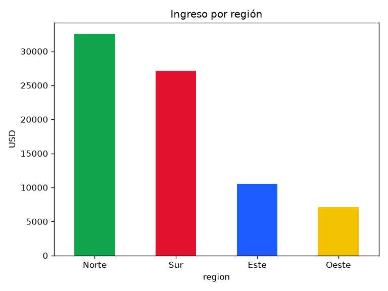
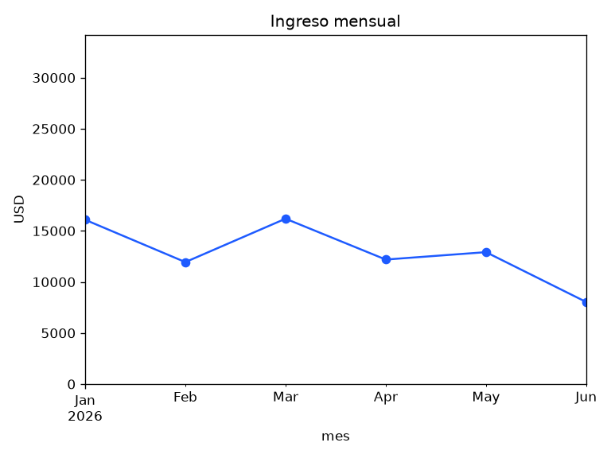
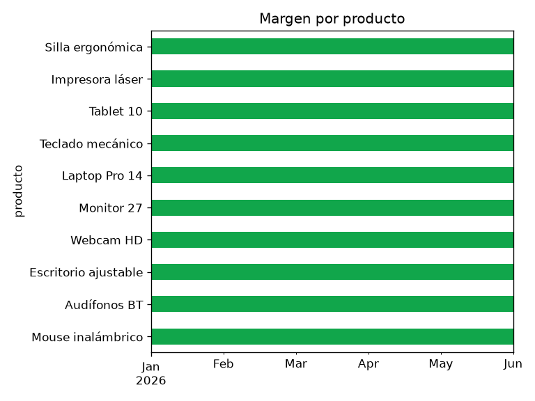
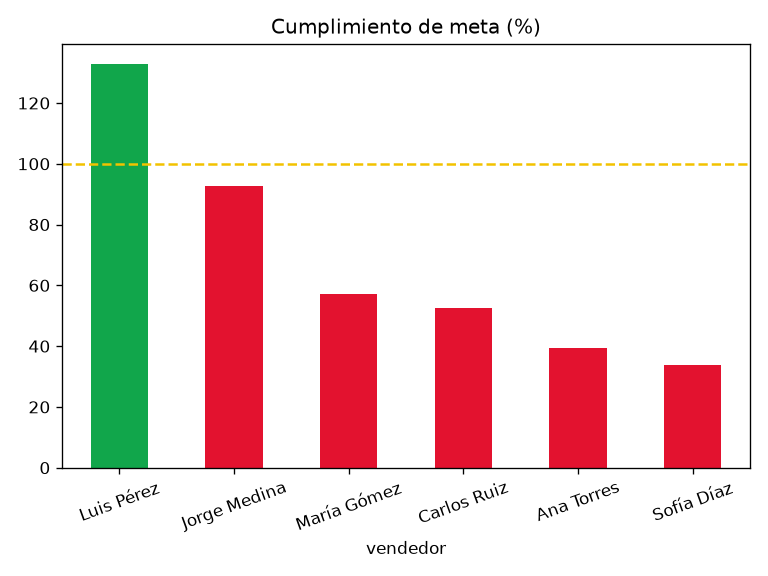

# Proyecto 3 · Análisis exploratorio con Python

**Pregunta:** ¿qué regiones, productos y vendedores explican los ingresos del semestre, y dónde hay oportunidades?

## Archivos

- **[analisis.ipynb](analisis.ipynb)** · notebook ejecutado (GitHub lo muestra con tablas y gráficos)
- `graficos/` · gráficos exportados
- `resumen_ventas.xlsx` · resumen exportado desde pandas
- `construir_notebook.py` · genera y ejecuta el notebook

## Proceso

1. Carga de CSV con `pd.read_csv`
2. Validación: tipos, vacíos y duplicados
3. Unión de tablas con `merge` y columnas de negocio (ingreso, margen, mes)
4. KPIs del semestre
5. `groupby` por región, mes, producto y vendedor
6. `pivot_table` región × canal
7. Gráficos con matplotlib
8. Exportación a Excel con `ExcelWriter`

## Gráficos

| Ingreso por región | Ingreso mensual |
|---|---|
|  |  |

| Margen por producto | Cumplimiento de meta |
|---|---|
|  |  |

## Conclusiones

1. Norte y Sur concentran el 77 % del ingreso.
2. Junio cayó 38 % frente a mayo.
3. Accesorios tiene el mejor margen relativo (44,5 %).
4. Solo 1 de 6 vendedores superó su meta.

**Recomendación:** campañas en Este y Oeste con productos de alto margen y revisión de metas por región.

## Cómo ejecutar

```bash
pip install pandas matplotlib openpyxl jupyter
python -m jupyter notebook analisis.ipynb
```

## Tu turno

1. Agrega una celda que calcule el **ingreso por día de la semana** (`df['fecha'].dt.day_name()`).
2. Encuentra el **vendedor con mejor ticket promedio**.
3. Haz un **gráfico de dispersión** de cantidad vs. ingreso.
4. Escribe una conclusión nueva en la última celda.
5. Guarda el notebook y súbelo con `git add`, `git commit` y `git push`.
