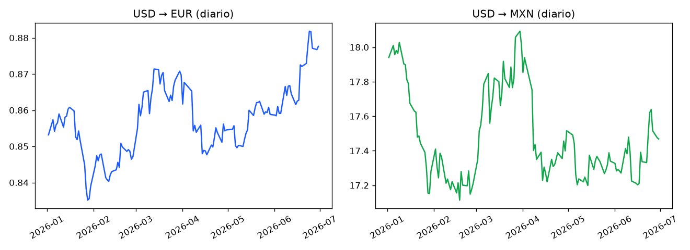
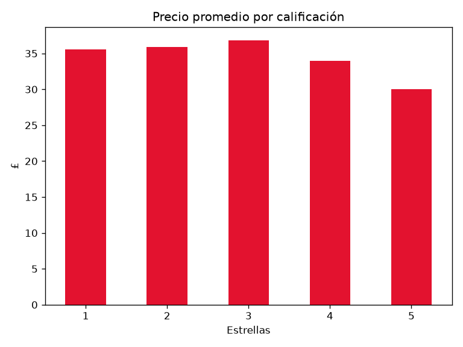

# Proyecto 4 · APIs y Web Scraping

Dos formas de **obtener datos** de internet y analizarlos.

## A) API pública: tipo de cambio del dólar

`api_tipo_cambio.py` consume la API gratuita [Frankfurter](https://www.frankfurter.app/) (sin clave) para obtener el tipo de cambio diario USD → EUR y USD → MXN del primer semestre de 2026.

- Petición con `requests.get`, parámetros, `timeout` y `raise_for_status()`
- Conversión de JSON anidado a DataFrame
- Promedio mensual con `resample`, variación y volatilidad

**Resultado:** en el semestre el dólar **se apreció 3,1 % frente al euro** y **se depreció 2,8 % frente al peso mexicano**.



## B) Web scraping ético: catálogo de libros

`scraping_libros.py` extrae 100 libros de [books.toscrape.com](https://books.toscrape.com), un sitio creado para practicar scraping.

- `requests` + `BeautifulSoup` con selectores CSS (`article.product_pod`, `.price_color`)
- Lectura de atributos (`title`, `class`, `href`)
- Paginación con pausa de 1 segundo entre páginas
- Limpieza de texto a números y mapeo de estrellas

**Resultado:** precio promedio **£34,56**; curiosamente, los libros con **5 estrellas son los más baratos** (£30,01 en promedio).



## Archivos generados

`tipo_cambio_diario.csv`, `tipo_cambio_mensual.csv`, `libros.csv` y los gráficos.

## Cómo ejecutar

```bash
pip install requests beautifulsoup4 pandas matplotlib
python api_tipo_cambio.py
python scraping_libros.py
```

## Buenas prácticas aplicadas

- Preferir una API oficial cuando existe
- `timeout` en cada petición y control del código de estado
- Pausas entre peticiones y User-Agent identificado
- Scraping solo de sitios que lo permiten

## Tu turno

1. Cambia la API para comparar **USD → GBP y JPY**.
2. Amplía el scraping a **10 páginas** y extrae también la categoría de cada libro (está en la página de detalle).
3. Calcula el **% de libros disponibles** por calificación.
4. Sube tus cambios con `git add`, `git commit` y `git push`.
