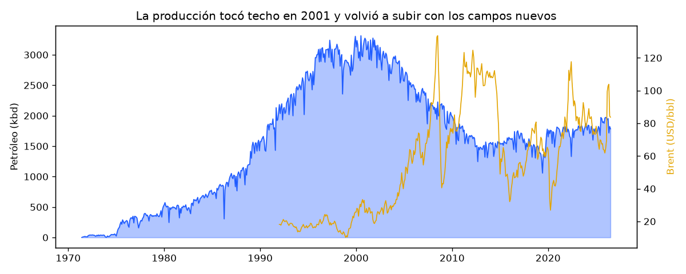
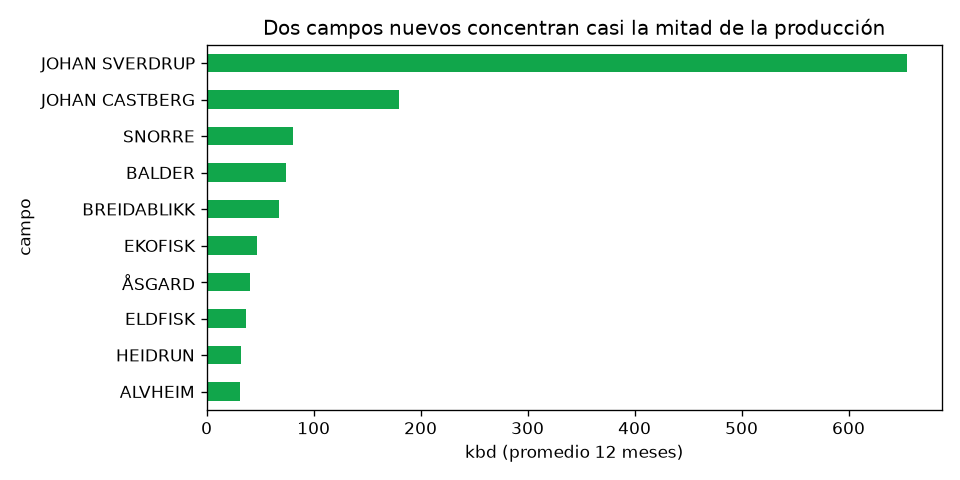
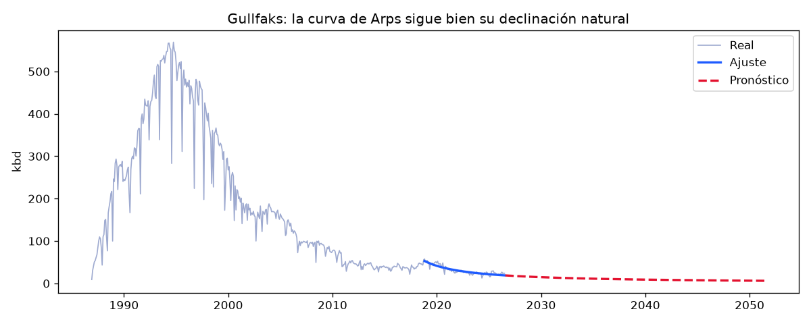
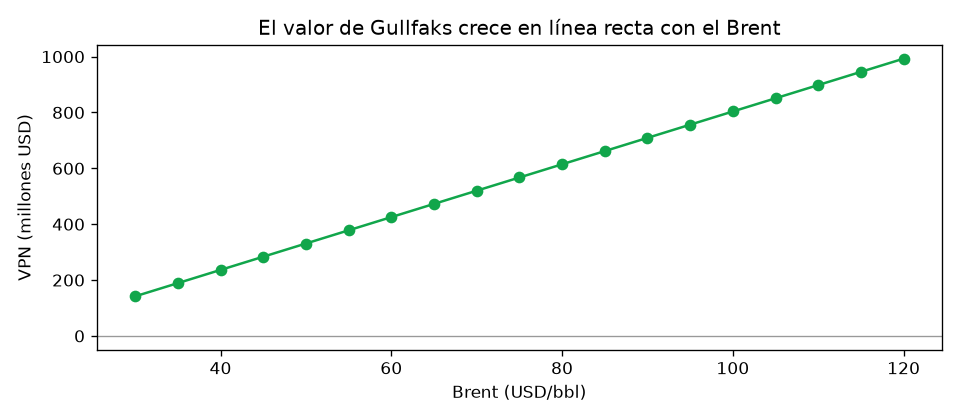

# Proyecto 07 · Producción y valor de los campos petroleros de Noruega

**[Ver el dashboard interactivo](https://miguellucho1111.github.io/portafolio-analista-datos/petroleo.html)** · Explorador de campos con curvas de declinación y simulador económico.

## La pregunta de negocio
¿Cómo evoluciona la producción de petróleo de la plataforma continental noruega, qué campos maduros sostienen el valor remanente y cuánto vale su producción futura según el precio del Brent?

Es la pregunta que se hace una operadora o una empresa de servicios cuando decide **dónde invertir**: en qué campos todavía queda petróleo, cuánto duran y cuánto valen.

## Por qué Noruega
Noruega publica, con licencia abierta, la producción **mensual de cada campo desde 1971** y sus reservas oficiales. Son datos reales, completos y verificables, que se actualizan cada mes. El mismo método sirve para cualquier cuenca, incluida la venezolana, cuando hay datos disponibles.

## Datos
| Archivo | Fuente | Contenido |
|---|---|---|
| `datos/produccion_mensual.csv` | [Sodir FactPages](https://factpages.sodir.no) (licencia NLOD) | Producción mensual neta por campo: petróleo, gas, NGL, condensado y agua |
| `datos/reservas.csv` | Sodir FactPages | Reservas recuperables y remanentes por campo |
| `datos/campos.csv` | Sodir FactPages | Operador, estado, área y tipo de hidrocarburo |
| `datos/brent_mensual.csv` | [FRED · POILBREUSDM](https://fred.stlouisfed.org/series/POILBREUSDM) | Precio promedio mensual del Brent |

Para traer los datos del último mes: `python actualizar_datos.py`.

## Método
1. **Limpieza** (`petro.py`): nombres de columnas en español, conversión de m³ estándar a barriles (1 Sm³ = 6,2898 bbl), caudales en miles de barriles por día (kbd) y corte de agua. Revisión de vacíos, duplicados y valores negativos (son correcciones que Sodir publica sobre meses anteriores).
2. **Análisis exploratorio:** tendencia nacional, concentración por campo, madurez (corte de agua) y reservas.
3. **Curvas de declinación de Arps:** ajuste de q(t) = qi / (1 + b·Di·t)^(1/b) desde el pico de producción hasta hoy, búsqueda en rejilla de b y Di, y pronóstico hasta un límite económico. Cada ajuste se califica con su R² y se compara con la reserva oficial.
4. **Evaluación económica:** valor presente neto del pronóstico con precio, costo operativo, impuestos (78 %, régimen noruego) y tasa de descuento ajustables.

El notebook y el dashboard usan **el mismo método** y sus números coinciden. Por ejemplo, en Gullfaks: R² de 0,73, 92,9 MMbbl según la curva y VPN de 596 millones de USD a 78 USD/bbl.

## Hallazgos (datos hasta julio de 2026)
1. **Cuenca madura que se reinventa:** la producción tocó techo en 2001 (3.117 kbd), cayó 55 % hasta 2019 (1.410 kbd) y se recuperó a unos 1.900 kbd gracias a campos nuevos.
2. **Riesgo concentrado:** Johan Sverdrup aporta el 34 % del petróleo del país y, junto con Johan Castberg, el 44 %.
3. **Más agua que petróleo:** el 61 % del líquido producido es agua, unos 1,6 barriles de agua por cada barril de petróleo.
4. **Valor remanente:** quedan 5.153 millones de barriles de reservas oficiales, unos 401 mil millones de USD de ingreso bruto al Brent promedio de 12 meses (78 USD/bbl).
5. **La curva de declinación sirve, con criterio:** de 53 campos que producen más de 5 kbd, 12 tienen un ajuste confiable (R² ≥ 0,6) y 13 siguen en meseta. El resto tiene una declinación irregular por pozos nuevos o intervenciones. Aun en los ajustes confiables, la curva difiere de la reserva oficial (79 % en la mediana) porque no sabe cuándo el operador cerrará el campo: **el límite económico pesa tanto como el ajuste**.
6. **El valor depende del precio:** en Gullfaks, el VPN pasa de 378 millones de USD con el Brent a 55 a 756 millones con el Brent a 95.

## Limitaciones
- Solo se evalúa el petróleo; el gas (muy importante en Noruega) queda para una próxima versión.
- El modelo económico no incluye inversiones, costos de abandono ni el costo real de cada campo.
- La curva de Arps no prevé pozos nuevos ni proyectos de recuperación mejorada.

## Archivos
| Archivo | Qué hace |
|---|---|
| [`analisis.ipynb`](analisis.ipynb) | Notebook ejecutado con todo el análisis, tablas y gráficos |
| `petro.py` | Funciones del proyecto: carga, limpieza, Arps y VPN |
| `actualizar_datos.py` | Descarga los datos oficiales más recientes |
| `construir_notebook.py` | Genera y ejecuta el notebook |
| `construir_web.py` | Genera `docs/petroleo_datos.js` para el dashboard |
| `graficos/` | Gráficos exportados |
| `GUIA.md` | Guía original del proyecto final (fases y lista de verificación) |

```bash
python actualizar_datos.py     # datos nuevos
python construir_notebook.py   # análisis
python construir_web.py        # dashboard
```

## Gráficos
| Producción nacional y Brent | Campos que más producen |
|---|---|
|  |  |

| Curva de declinación de Gullfaks | Valor según el Brent |
|---|---|
|  |  |

## Tu turno
- [ ] Agregar el gas al pronóstico y al valor (precio del gas europeo).
- [ ] Comparar dos operadores: ¿quién tiene campos más maduros?
- [ ] Calcular la declinación anual promedio de la cuenca.
- [ ] Repetir el análisis con otra cuenca con datos abiertos (por ejemplo Dakota del Norte o el Reino Unido).
- [ ] Explicar en voz alta, sin mirar, qué significan qi, Di y b.

---
Proyecto de aprendizaje: yo dirijo el análisis y lo estudio paso a paso; la programación la hice con apoyo de IA.
